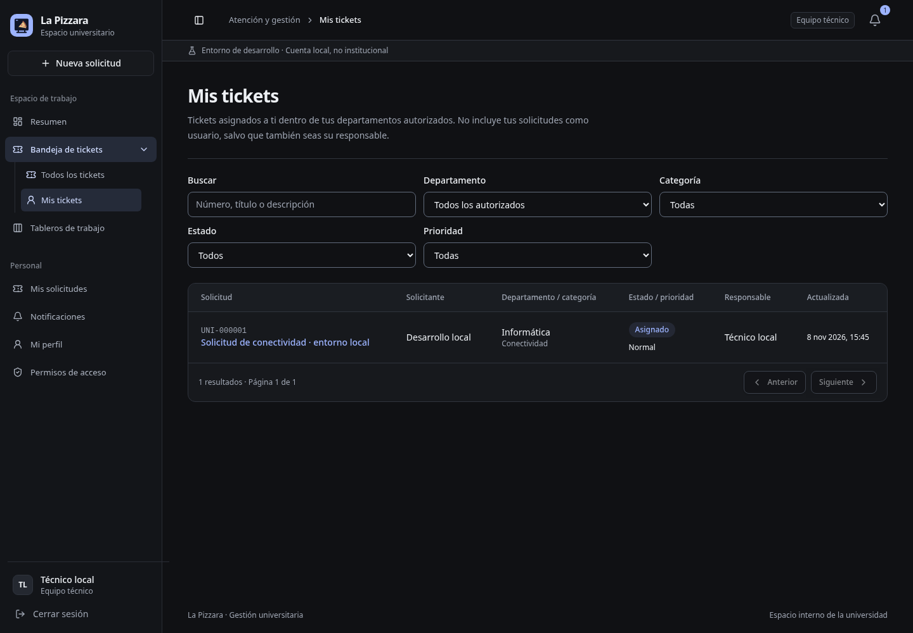
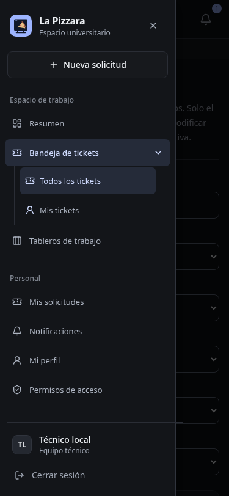

# Bandeja desplegable y Mis tickets

Verificación local: 8 de noviembre de 2026.

## Alcance

Cambios en `Shell.tsx`, `router.tsx` y `StaffTicketsPage.tsx`. Se reutiliza el filtro REST `assignedToId`: el repositorio combina este filtro con permisos antes de paginar y contar. No cambia el backend ni se crean migraciones.

## Comprobaciones ejecutadas

- `pnpm --filter web build`: TypeScript y Vite correctos. Persisten avisos no fatales de anotaciones PURE de Zod y bundle >500 kB.
- Chromium, escritorio 1440×1000 y móvil 375×812, contra API local aislada en 3111 y frontend en 5178.
- SQLite obtenida mediante Online Backup de la base local; cuentas, departamento y ticket existentes. La asignación de revisión se realizó solo en la copia, sin semillas ni mocks.
- Técnico: la petición lleva su ID real de sesión; devuelve un ticket y todos los resultados tienen ese responsable. ADMIN sin asignaciones: cero resultados, excluyendo el ticket asignado al técnico.
- Mis tickets oculta el selector Responsable; Todos los tickets lo recupera. Rutas `/staff/tickets/mine` y `/admin/tickets/mine`, enlace activo y breadcrumb correctos.
- Enter/Espacio abren/cierran el desplegable. Desde el sidebar plegado, el botón expande sidebar y submenú. En móvil, seleccionar una opción cierra el Sheet; ancho de documento 375/375 sin desbordamiento global.
- Recargar conserva Mis tickets; `/app/tickets` continúa mostrando Mis solicitudes. Sin errores JavaScript en ambas sesiones revisadas.

No se probó login institucional ni despliegue de producción. Los procesos de revisión se detuvieron al terminar, sin detener los servicios del usuario. La base habitual no fue modificada por estas comprobaciones.

## Capturas

