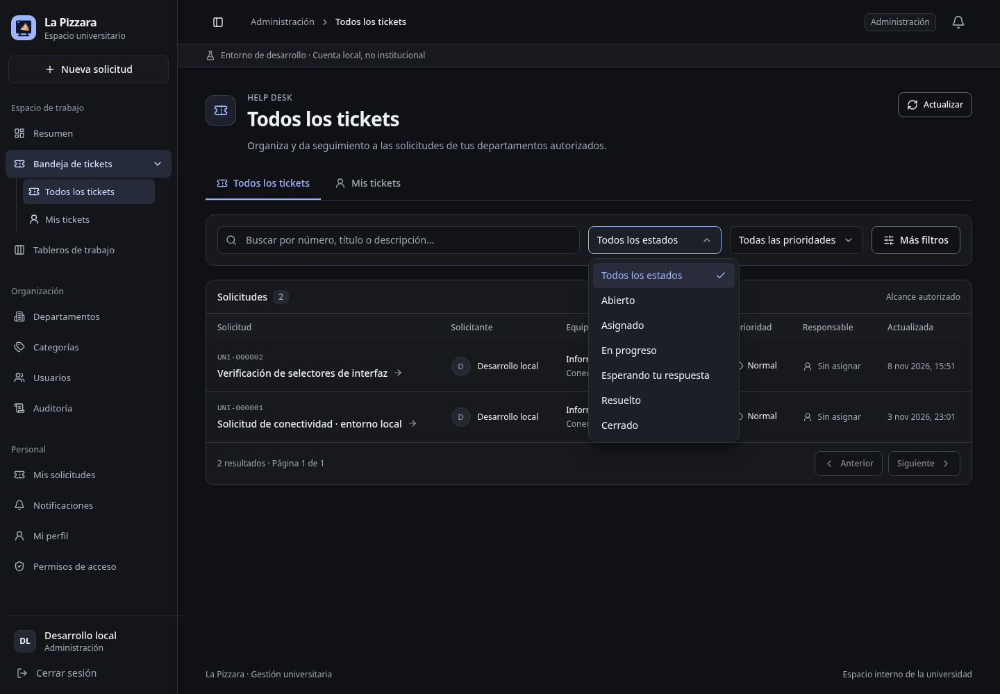
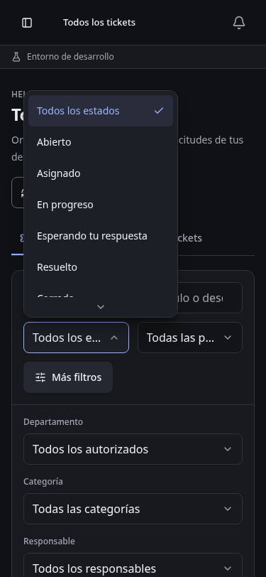

# Selectores y bandeja de tickets

Verificación local: 8 de noviembre de 2026.

## Implementación

Select shadcn/ui sobre Radix, adaptado a los tokens existentes. 39 selectores sustituidos; ninguna etiqueta JSX `select`, `option` u `optgroup` permanece en `apps/web/src`. Radix mantiene su propio control oculto para integración HTML; no se usa como adaptador de eventos para RHF. `FormSelect` utiliza `useController`.

Referencia: [Select shadcn/Radix](https://ui.shadcn.com/docs/components/radix/select).

La bandeja conserva las consultas autorizadas existentes, la separación Todos/Mis tickets y la paginación del servidor. Se renombra el título de la vista general a **Todos los tickets**, coherente con la navegación.

## Ejecutado

- `pnpm typecheck`: shared, API y web correctos.
- `pnpm --filter web build`: correcto; permanecen avisos no fatales PURE de Zod y bundle >500 kB.
- `git diff --check`: sin errores.
- Chromium con API 3111/frontend 5178 y copia SQLite por Online Backup. Se utilizaron cuentas y registros existentes; los registros nuevos de revisión se guardaron únicamente mediante formularios/API reales en esa copia. Sin mocks, semillas de aplicación ni nueva suite automatizada.
- Filtro de estado recibido por la API y resultados coincidentes. Activación en departamentos/categorías/usuarios; cancelación de cambio de rol conserva el valor original.
- Nueva solicitud: categoría requerida inválida al enviar vacío; grupos por departamento; selección real y persistencia HTTP 201.
- Detalle: asignación HTTP 200 y desasignación HTTP 200 con `assignedToId: null` en el cuerpo. Cambiar departamento limpia categoría y responsable en el formulario.
- Categoría interna de tablero: elección de color y creación HTTP 201; `reset` devuelve el control visual a Violeta.
- Selector de prioridad en diálogo de tarea usable sin cerrar el diálogo. Cambio de columna desde lista y filtros Kanban con URL; limpiar prioridad elimina el parámetro.
- Escape restaura el foco al trigger. Móvil 375×812: documento 375/375, popup dentro del viewport y opciones con objetivo táctil mínimo de 44px. Capturas revisadas tras terminar la animación.
- Estado y prioridad combinados llegan juntos al servidor. Una búsqueda sin coincidencias devuelve cero; limpiar recupera la tabla y quitar una etiqueta conserva el resto de filtros. Mis tickets no ofrece cambiar el responsable.
- Con un `fieldset` deshabilitado, el trigger no abre el popup: se corrigió la entrega de `pointerdown` de Chromium antes del bloqueo nativo de `click`. En viewport 375×360, el popup queda dentro de pantalla y End/Enter permite seleccionar Cerrado con scroll. El identificador visual de opción vacía no aparece en las solicitudes.
- Sin errores JavaScript en las sesiones de escritorio y móvil revisadas.

## Límites

No se repitieron todos los flujos de negocio de cada formulario. No cambian backend, autorización, contratos ni migraciones. No se prueba AD institucional ni producción. No se reconstruyeron imágenes Docker. Los procesos aislados de revisión se detuvieron al terminar sin parar los servicios del usuario.

## Capturas

