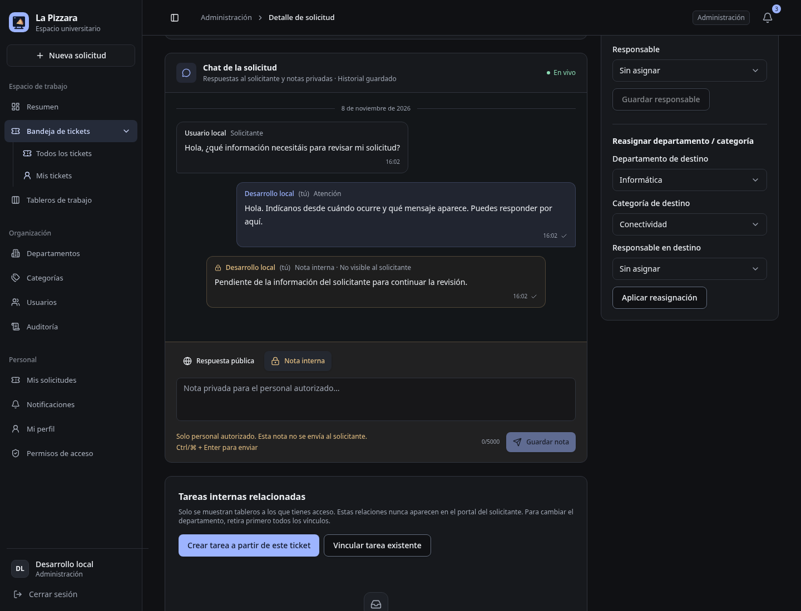
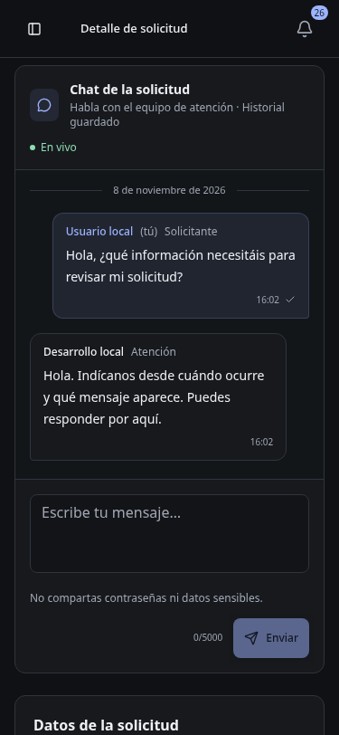

# Verificación del chat de tickets

Fecha: 8 de noviembre de 2026. Entorno local aislado, no aceptación institucional.

## Comprobaciones ejecutadas

- API y web compiladas; `pnpm typecheck` correcto para shared/API/web. `git diff --check` sin errores. Persisten avisos no fatales PURE de Zod y bundle >500 kB.
- OpenAPI 1.9.0: extensión `x-websocket` y descripciones de comentarios; contratos REST sin cambios de forma/rutas. `postman spec lint ... --issueType syntax --output json`: `{"violations": []}`. No equivale a governance remoto.
- API 3111 y frontend 5178, con copia SQLite mediante Online Backup. Cuentas existentes ADMIN y USER, sesiones independientes creadas por la entrada local real. Las solicitudes/mensajes de revisión se crearon solo mediante UI/API en la copia. Sin mocks, semillas de aplicación, contraseñas inventadas ni suites nuevas.
- Usuario → administrador y administrador → usuario sin recarga: ~0,17 s cada dirección en la ejecución medida. Captura de frames confirmó `42["tickets:changed"]`, sin payload ni cuerpos de mensajes.
- Mensaje nuevo no borra el borrador. Nota interna visible al personal, ausente en GET público y sin señal de ticket al solicitante. Un USER ajeno tampoco recibe señal por cambios en otro ticket.
- POST sin CSRF: 403. USER en escritura staff: 403. Lectura pública de otro propietario: 404. POST tras cerrar: 409.
- Historial de 23 mensajes públicos cargado en varias páginas, sin IDs duplicados; una respuesta nueva tras cargar anteriores mantiene el punto de lectura y ofrece el botón Nuevos mensajes. El historial sobrevive a recarga.
- Reinicio real de la API aislada, conservando base y sesiones: el transporte reconecta, recupera el historial y conserva el borrador en memoria. Cierre posterior se propaga y elimina el compositor del usuario sin recargar.
- Comparación del `expires_at` de la sesión antes/después de lecturas de chat y conexión socket: sin prolongación de inactividad.
- Ensayo adicional en otra copia SQLite con las clases reales de repositorio/servicio: evento revertido no queda persistido ni emite señal; evento confirmado emite una. No se ejecutó una segunda API sobre la misma copia.
- Chromium 1440 px y 375×812: sin errores JavaScript en el intercambio y documento móvil 375/375. Ajustada altura del chat móvil para que Enviar quede dentro de pantalla; avisos móviles arriba para no cubrir el compositor.

## Petición guardada de Postman

Se ejecutó **solo** Consultar comentarios públicos del ticket propio, con ID real de revisión y cookie jar privado en `/tmp`, contra la API aislada. `--no-report-events`, sin publicación ni otras peticiones/escrituras de la colección.

Resultado de la CLI:

```text
GET .../comments?page=1&limit=20 [200 OK, 6.02 KB, 11 ms]
iterations        executed 1   failed 0
requests          executed 1   failed 0
test-scripts      executed 0   failed 0
prerequest-scripts executed 0   failed 0
assertions        executed 0   failed 0
total run duration: 31 ms
```

Exit code 0. La CLI advirtió `No authorization data found. Please use the postman login command.` sobre su cuenta Postman; la petición local autenticada por cookie sí devolvió 200. No se inició sesión ni se actualizó la CLI. Esta petición no incluye assertions; las comprobaciones de permisos, persistencia y WebSocket son las revisiones reales descritas arriba, no garantías inferidas de un 200.

## Límites y limpieza

No se repitió toda la colección acumulada ni los flujos LDAP/producción. No hay prueba institucional de LDAPS, WSS o despliegue. No se reconstruyeron imágenes Docker. Los procesos de revisión se detuvieron; no se pararon servicios del usuario ni se modificó su SQLite habitual. No se hizo commit/push.

## Capturas




